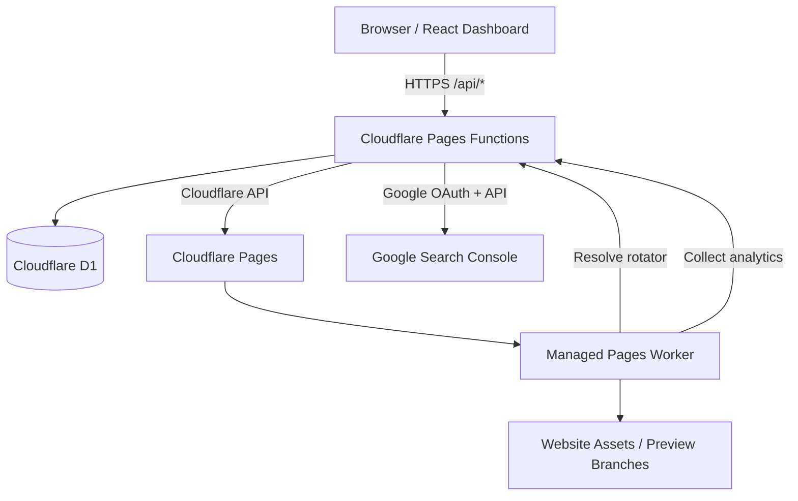

# Pages Manager

**Cloudflare Pages Control Plane** — dashboard untuk mengelola project Cloudflare Pages, deployment, traffic routing, analytics, dan integrasi Google Search Console dari satu workspace.

> **Versi source:** `2.8.3`  
> **Platform utama:** Cloudflare Pages + Pages Functions + D1  
> **Frontend:** React + TypeScript + Vite

Pages Manager dibuat untuk mengelola beberapa project dan akun Cloudflare melalui satu dashboard. Setiap pengguna menghubungkan API Token Cloudflare miliknya sendiri. Kredensial disimpan oleh backend secara terenkripsi dan tidak dibagikan antar pengguna.

---

## Daftar isi

- [Fitur utama](#fitur-utama)
- [Arsitektur dan cara kerja](#arsitektur-dan-cara-kerja)
- [Traffic rotator](#traffic-rotator)
- [Analytics](#analytics)
- [Google Search Console](#google-search-console)
- [SEO audit dan proses deployment](#seo-audit-dan-proses-deployment)
- [Teknologi](#teknologi)
- [Struktur project](#struktur-project)
- [Persyaratan](#persyaratan)
- [Instalasi dan konfigurasi](#instalasi-dan-konfigurasi)
- [Menjalankan secara lokal](#menjalankan-secara-lokal)
- [Build dan deploy ke Cloudflare Pages](#build-dan-deploy-ke-cloudflare-pages)
- [Permission Cloudflare API Token](#permission-cloudflare-api-token)
- [Environment variables dan secrets](#environment-variables-dan-secrets)
- [Database migrations](#database-migrations)
- [Batasan teknis](#batasan-teknis)
- [Keamanan dan privasi](#keamanan-dan-privasi)
- [Troubleshooting](#troubleshooting)
- [Kontribusi](#kontribusi)
- [Lisensi](#lisensi)

---

## Fitur utama

### Cloudflare Pages workspace

- Menghubungkan akun Cloudflare menggunakan API Token pribadi.
- Mendukung beberapa akun Cloudflare dalam satu sesi apabila token memiliki akses ke beberapa akun.
- Menampilkan inventaris project Pages dari akun yang dipilih.
- Pencarian, sorting, tampilan card/list, dan pagination project.
- Membuat dan menghapus project Pages.
- Melihat riwayat deployment, branch, URL, deployment ID, serta status deployment.
- Memilih akun Cloudflare aktif dari halaman Settings.

### Deployment manager

- Direct Upload file atau folder website ke Cloudflare Pages.
- Deploy ke production branch maupun preview branch.
- Membuat project baru sekaligus mengunggah website.
- Memantau progres upload, pemrosesan asset, dan status deployment.
- Memastikan deployment mencapai status `success` sebelum proses lanjutan yang bergantung pada website aktif dijalankan.
- Menggunakan checksum BLAKE3 yang dihitung di browser melalui Web Worker.
- Menambahkan Cloudflare Pages Worker (`_worker.js`) untuk fitur routing dan analytics yang dikelola Pages Manager.

### Traffic rotator

- Membuat preview branch sebagai edge/alias dalam project Pages yang sama.
- Menghasilkan nama branch secara acak atau menggunakan nama custom.
- Menambahkan target URL HTTPS eksternal, misalnya project Pages lain atau custom domain.
- Tiga mode distribusi traffic:
  - **Random** — memilih target aktif secara acak.
  - **Weighted random** — memilih target berdasarkan bobot.
  - **Round-robin** — membagi kunjungan secara bergiliran.
- Mengaktifkan atau menonaktifkan target, mengatur bobot, serta mengurutkan target.
- Memvalidasi deployment dan alias preview branch sebelum konfigurasi rotator disimpan.
- Redirect dilakukan di edge menggunakan HTTP `302`.

### Analytics

- Mengumpulkan pageview dan click event dari website yang memakai Worker Pages Manager.
- Menampilkan ringkasan views, unique visitors, clicks, dan sessions.
- Menampilkan grafik aktivitas harian.
- Mengelompokkan traffic berdasarkan perangkat, negara/lokasi, dan referrer.
- Menyediakan daftar event terbaru.
- Mendukung halaman HTML biasa dan AMP.
- Data analytics dipisahkan berdasarkan akun Cloudflare dan nama project.

### Google Search Console

- Menghubungkan satu atau beberapa akun Google.
- Menampilkan inventaris property yang dapat diakses oleh akun Google aktif.
- Menyiapkan file verifikasi kepemilikan pada website.
- Memverifikasi property dan mendaftarkannya ke Search Console.
- Mengirim sitemap XML.
- Memeriksa status indexing URL melalui URL Inspection API.
- Membaca performa Search Console seperti clicks, impressions, CTR, average position, dan search queries.
- Menghubungkan property Google dengan project Cloudflare yang dikelola.
- Menawarkan opsi penambahan property Google Search Console ketika production website di-deploy. Proses pendaftaran dan submit sitemap dilanjutkan setelah deployment sukses.

### SEO technical layer

Saat website di-deploy melalui Pages Manager, proses deployment dapat menambahkan atau memperbarui beberapa komponen teknis SEO:

- Audit awal untuk title, meta description, H1, bahasa dokumen, viewport, Open Graph, JSON-LD, canonical, image alt, internal links, dan aturan noindex.
- Pemeriksaan khusus markup AMP.
- Canonical otomatis hanya jika halaman belum memiliki canonical.
- Hubungan `rel="amphtml"` untuk pasangan halaman AMP.
- Pembuatan `robots.txt` dan `sitemap.xml` apabila file tersebut belum disediakan.
- Pembuatan sitemap dari URL HTML yang memenuhi aturan indeksasi.
- Header `X-Robots-Tag: noindex` untuk preview branch.

> SEO audit adalah pemeriksaan teknis dan bukan prediksi ranking, jaminan indexing, atau jaminan traffic dari mesin pencari.

### Workspace dan pengaturan

- Overview terpusat untuk inventaris Cloudflare Pages dan Google Search Console.
- Halaman Google Properties untuk melihat semua property dari akun Google aktif.
- Settings untuk mengelola akun Cloudflare, akun Google, dan tema.
- Tema dark/light.
- Sidebar dapat diciutkan menjadi tampilan ikon.
- Activity log operasi dashboard disimpan di D1.

---

## Arsitektur dan cara kerja

Pages Manager terdiri dari frontend dashboard, API backend yang berjalan sebagai Cloudflare Pages Functions, dan database Cloudflare D1.



### Komponen

| Komponen | Tanggung jawab |
|---|---|
| React + Vite | Antarmuka dashboard, form deployment, analytics, rotator, dan pengaturan. |
| Cloudflare Pages | Hosting frontend dan runtime Pages Functions. |
| Pages Functions | Autentikasi, integrasi API Cloudflare/Google, upload deployment, rotator resolver, dan analytics collector. |
| Cloudflare D1 | Menyimpan sesi, konfigurasi, inventaris, activity log, event analytics, dan data integrasi Google. |
| Managed Pages Worker | Menjalankan routing, tracking, SEO technical layer, dan penyajian asset website yang di-deploy. |
| Cloudflare Pages API | Mengelola project dan deployment pada akun Cloudflare pengguna. |
| Google APIs | OAuth, Search Console, Site Verification, sitemap, URL Inspection, dan data performa. |

### Alur autentikasi Cloudflare

1. Pengguna memasukkan Cloudflare API Token melalui halaman login.
2. Backend memvalidasi token ke Cloudflare API dan membaca profil serta daftar akun yang dapat diakses.
3. Token dienkripsi menggunakan AES-GCM sebelum disimpan di D1.
4. Browser menerima session cookie `HttpOnly` yang ditandatangani HMAC-SHA256.
5. Request dashboard berikutnya menggunakan sesi tersebut. Token Cloudflare tidak dikirim kembali ke browser.
6. Data operasional dipisahkan berdasarkan Cloudflare Account ID.

Sesi dashboard memiliki masa berlaku tujuh hari. Jika token mencakup lebih dari satu akun, pengguna dapat memilih akun aktif dari Settings.

---

## Traffic rotator

Rotator menggunakan satu project Cloudflare Pages sebagai domain induk dan satu atau lebih branch preview sebagai tujuan.

Contoh:

- Domain induk: `https://my-project.pages.dev`
- Branch preview: `campaign-a`
- Alias preview: `https://campaign-a.my-project.pages.dev`

Saat rotator aktif, Worker yang terpasang pada production branch akan meminta konfigurasi rotator lalu mengirim pengunjung dengan HTTP `302` ke target yang dipilih. Request pada alias preview tidak diputar kembali sehingga tidak membentuk redirect loop.

Target rotator dapat berupa:

- Branch preview dari project yang sama.
- URL HTTPS langsung, seperti project Pages lain atau custom domain.

Untuk target branch, Pages Manager memeriksa bahwa deployment branch sukses dan alias branch sudah tersedia sebelum konfigurasi diaktifkan.

### Catatan SEO penting

Ketika rotator aktif pada domain produksi, halaman utama akan mengirim HTTP `302` ke target yang dapat berubah. Preview branch yang dikelola Pages Manager juga diberi `X-Robots-Tag: noindex`. Karena itu, rotator tidak disarankan pada domain utama yang ingin mempertahankan satu URL konten kanonis untuk SEO organik. Gunakan production branch tanpa rotator untuk website utama yang berorientasi SEO.

---

## Analytics

Worker yang dihasilkan saat deployment mengirim event ke endpoint dashboard secara server-to-server.

- Website HTML biasa menggunakan client tracker ringan pada path `/__pm/client.js`.
- Halaman AMP menggunakan `<amp-analytics>` dan endpoint tracking yang kompatibel dengan AMP. Script tracker biasa tidak disisipkan ke halaman AMP.
- Event dikirim ke `/api/collect` dan disimpan ke tabel `analytics_events` di D1.
- Worker meneruskan metadata request seperti user agent, IP, negara, region, kota, timezone, dan Cloudflare colo jika tersedia.
- Dashboard mengagregasi event per project dan akun Cloudflare.

Analytics hanya mulai bekerja pada deployment yang memasang Worker Pages Manager. Website yang sudah di-deploy sebelum menggunakan fitur ini perlu di-deploy ulang melalui dashboard.

> **Privasi:** data IP dan lokasi termasuk data pengunjung. Pada kunjungan melalui AMP Cache, beberapa metadata request dapat merepresentasikan jalur cache dan tidak selalu sama dengan akses langsung ke origin. Pemilik website bertanggung jawab menyediakan pemberitahuan privasi yang sesuai, menentukan retensi data, dan memenuhi aturan perlindungan data yang berlaku.

---

## Google Search Console

Integrasi Google menggunakan OAuth 2.0. Akun Google yang terhubung disimpan per pengguna, sehingga satu pengguna dapat menghubungkan beberapa identitas Google dan memilih akun aktif.

Fitur Google pada dashboard mencakup:

1. Sinkronisasi daftar property yang dapat diakses akun aktif.
2. Persiapan file verifikasi Google.
3. Verifikasi kepemilikan property.
4. Pendaftaran property ke Search Console.
5. Submit atau submit ulang sitemap.
6. URL Inspection untuk melihat informasi indexing yang disediakan Google.
7. Data performa Search Console, termasuk klik, impression, CTR, posisi rata-rata, dan query.

Google biasanya menerbitkan data performa dengan jeda. Submit sitemap hanya memberi tahu Google lokasi sitemap; hal tersebut tidak menjamin URL langsung di-crawl atau di-index.

### Konfigurasi Google OAuth

1. Buat project pada Google Cloud Console.
2. Aktifkan Google Search Console API dan Google Site Verification API.
3. Buat OAuth 2.0 Client ID untuk aplikasi web.
4. Tambahkan Authorized redirect URI:

   ```text
   https://YOUR-DASHBOARD-DOMAIN/api/google/callback
   ```

5. Simpan Client ID, Client Secret, dan redirect URL sebagai Cloudflare Pages secrets.

Integrasi Google bersifat opsional. Dashboard dan fitur Cloudflare dapat digunakan tanpa menghubungkan akun Google, tetapi fitur Search Console memerlukan konfigurasi OAuth tersebut.

---

## SEO audit dan proses deployment

Ketika pengguna memilih file atau folder website, SEO Expert menjalankan audit teknis di browser sebelum deployment. Saat upload, dashboard menghitung checksum asset melalui Web Worker dan mengirim asset ke Cloudflare Pages Direct Upload.

Setiap deployment yang dikelola Pages Manager menyertakan Worker untuk routing dan analytics. Pada proses production deployment yang meminta integrasi Google, alurnya adalah:

1. Menyiapkan informasi verifikasi Google.
2. Mengirim website ke Cloudflare Pages.
3. Memeriksa status deployment menggunakan metadata deployment Cloudflare.
4. Menunggu status `success` dengan polling bertahap dan batas waktu.
5. Setelah status sukses, melanjutkan verifikasi/pendaftaran property dan submit sitemap.

Polling deployment menggunakan jeda bertahap dengan jumlah percobaan terbatas (sekitar 165 detik maksimum pada konfigurasi saat ini). Ini bukan polling tanpa batas. Dashboard tidak melakukan request `HEAD`/`GET` berulang ke setiap domain `*.pages.dev` untuk mengecek status karena request tersebut dapat memanggil Worker situs yang dikelola dan menambah penggunaan kuota.

Jika proses verifikasi Google gagal, deployment website tidak dibatalkan. Proses Google dapat diperiksa atau dicoba ulang dari halaman Google Search project.

---

## Teknologi

- **React** — UI dashboard.
- **TypeScript** — tipe dan pemeriksaan source.
- **Vite** — development server dan build frontend.
- **Cloudflare Pages** — hosting aplikasi.
- **Cloudflare Pages Functions** — API backend.
- **Cloudflare D1** — database SQL berbasis SQLite.
- **Cloudflare Pages API** — operasi project, asset, dan deployment.
- **Google OAuth 2.0 / Search Console APIs** — integrasi pencarian Google.
- **Web Crypto API** — enkripsi AES-GCM, HMAC-SHA256, dan hashing.
- **BLAKE3 (`@noble/hashes`)** — checksum asset dari browser.
- **Lucide React** — ikon antarmuka.

---

## Struktur project

```text
.
├── functions/
│   ├── _middleware.ts              # Pemeriksaan sesi untuk API
│   ├── api/
│   │   └── [[path]].ts             # API backend Pages Manager
│   └── _lib/
│       └── project-registry.ts     # Identitas internal project
├── migrations/
│   ├── 0001_init.sql
│   ├── 0002_analytics_and_edge_rotator.sql
│   ├── 0003_multi_account_oauth.sql
│   ├── 0004_google_search_console.sql
│   ├── 0005_project_registry.sql
│   └── 0006_multi_google_accounts.sql
├── public/
│   └── _redirects
├── src/
│   ├── app/                        # Pemetaan route aplikasi
│   ├── features/
│   │   └── settings/               # Pengaturan akun dan tema
│   ├── pages/
│   │   ├── cloudflare/
│   │   │   ├── analytics/
│   │   │   ├── deployments/
│   │   │   └── rotator/
│   │   └── google-search/
│   ├── shared/                    # API client, tipe, helper
│   ├── App.tsx
│   ├── asset-hash.worker.ts        # Checksum asset di browser
│   ├── main.tsx
│   └── style.css
├── index.html
├── package.json
├── tsconfig.json
├── vite.config.ts
└── wrangler.toml                   # Binding Cloudflare D1 dan Pages
```

### Route utama dashboard

| Route | Fungsi |
|---|---|
| `/login` | Menghubungkan API Token Cloudflare. |
| `/app/overview` | Ringkasan dan inventaris project. |
| `/app/projects/:projectId/deployments` | Create project, upload website, deployment history. |
| `/app/projects/:projectId/rotator` | Pengaturan edge dan traffic rotator. |
| `/app/projects/:projectId/analytics` | Analytics website. |
| `/app/projects/:projectId/google-search` | Google Search Console untuk project. |
| `/app/google-search` | Inventaris Google properties. |
| `/app/settings` | Pengaturan akun Cloudflare, Google, dan tema. |

---

## Persyaratan

Sebelum menjalankan project, siapkan:

- Node.js `20.19.0` atau lebih baru pada jalur 20.x, atau `22.12.0` atau lebih baru pada jalur 22.x (mengikuti kebutuhan Vite pada lockfile project ini).
- npm.
- Akun Cloudflare.
- Cloudflare Pages project untuk meng-host dashboard.
- Cloudflare D1 database.
- Cloudflare API Token dengan permission yang dijelaskan pada bagian [Permission Cloudflare API Token](#permission-cloudflare-api-token).
- Google Cloud project dan OAuth credentials jika ingin memakai integrasi Google Search Console.
- Wrangler CLI. Tidak perlu instalasi global karena perintah dapat dijalankan melalui `npx wrangler`.

---

## Instalasi dan konfigurasi

### 1. Clone repository

```bash
git clone https://github.com/YOUR-USERNAME/pages-manager.git
cd pages-manager
npm install
```

Ganti URL repository dengan alamat repository Anda.

### 2. Login ke Cloudflare

```bash
npx wrangler login
```

Pastikan akun Cloudflare yang digunakan memiliki izin untuk membuat dan mengelola Pages project serta D1 database.

### 3. Buat database D1

```bash
npx wrangler d1 create pages-manager-db
```

Cloudflare akan mengembalikan `database_id`. Buka `wrangler.toml`, lalu sesuaikan konfigurasi database dengan database milik Anda:

```toml
[[d1_databases]]
binding = "DB"
database_name = "pages-manager-db"
database_id = "YOUR_D1_DATABASE_ID"
migrations_dir = "migrations"
```

`database_id` adalah identifier resource D1 milik deployment Anda, bukan secret autentikasi. Jangan memakai database ID dari project orang lain. Pastikan binding tetap bernama `DB` karena Functions mengakses database melalui `env.DB`.

### 4. Terapkan database migrations

Jalankan seluruh migration secara berurutan ke database remote:

```bash
npx wrangler d1 migrations apply pages-manager-db --remote
```

Periksa statusnya:

```bash
npx wrangler d1 migrations list pages-manager-db --remote
```

Jangan menghapus database yang sudah berisi data untuk melakukan upgrade. Gunakan migration yang tersedia agar data sesi, project, analytics, dan akun Google tetap dipertahankan.

### 5. Konfigurasikan `SESSION_SECRET`

Buat secret acak minimal 32 karakter. Contoh menggunakan OpenSSL:

```bash
openssl rand -hex 32
```

Simpan sebagai Cloudflare Pages secret:

```bash
npx wrangler pages secret put SESSION_SECRET --project-name=pages-manager
```

Gunakan nilai secret yang sama untuk deployment production dan environment yang perlu mengakses data terenkripsi yang sama. Jangan masukkan nilainya ke `wrangler.toml`, frontend, repository, atau file dokumentasi.

### 6. Konfigurasikan Google OAuth (opsional)

Jika integrasi Google Search Console akan digunakan, tambahkan secrets berikut:

```bash
npx wrangler pages secret put GOOGLE_OAUTH_CLIENT_ID --project-name=pages-manager
npx wrangler pages secret put GOOGLE_OAUTH_CLIENT_SECRET --project-name=pages-manager
npx wrangler pages secret put GOOGLE_OAUTH_REDIRECT_URL --project-name=pages-manager
```

Gunakan redirect URL dengan format:

```text
https://YOUR-DASHBOARD-DOMAIN/api/google/callback
```

Nilai `GOOGLE_OAUTH_REDIRECT_URL` harus sama persis dengan Authorized redirect URI pada Google Cloud Console, termasuk scheme, hostname, dan path.

### 7. Buat atau siapkan Cloudflare Pages project

Buat project Pages bernama `pages-manager` melalui Cloudflare Dashboard atau Wrangler. Jika nama project berbeda, gunakan nama tersebut secara konsisten pada perintah deploy dan secret.

Pastikan D1 database binding `DB` tersedia pada Pages project yang menjalankan dashboard. Konfigurasi binding disimpan di `wrangler.toml`.

---

## Menjalankan secara lokal

### Frontend development server

```bash
npm run dev
```

Perintah ini menjalankan Vite untuk pengembangan frontend. API Pages Functions dan binding D1 tidak otomatis tersedia pada Vite dev server biasa.

### Pages Functions lokal

Buat file `.dev.vars` di root project untuk nilai secret lokal. File ini sudah masuk `.gitignore` dan tidak boleh di-commit.

```env
SESSION_SECRET=replace-with-a-random-secret-at-least-32-characters

# Opsional untuk integrasi Google Search Console
GOOGLE_OAUTH_CLIENT_ID=your-google-client-id
GOOGLE_OAUTH_CLIENT_SECRET=your-google-client-secret
GOOGLE_OAUTH_REDIRECT_URL=http://localhost:8788/api/google/callback
```

Build frontend terlebih dahulu, lalu jalankan Cloudflare Pages local runtime:

```bash
npm run build
npx wrangler pages dev dist
```

Untuk OAuth Google lokal, tambahkan `http://localhost:8788/api/google/callback` sebagai Authorized redirect URI pada OAuth client pengujian. Pengaturan callback lokal dan production harus sesuai dengan origin masing-masing.

---

## Build dan deploy ke Cloudflare Pages

Build production:

```bash
npm install
npm run build
```

Hasil build frontend akan dibuat ke folder `dist/`.

Deploy melalui Wrangler CLI:

```bash
npx wrangler pages deploy dist --project-name=pages-manager
```

Atau hubungkan repository Git ke Cloudflare Pages dengan pengaturan:

| Pengaturan | Nilai |
|---|---|
| Framework preset | `Vite` atau `None` |
| Build command | `npm run build` |
| Build output directory | `dist` |
| Root directory | `/` |

Pastikan D1 binding dan Pages secrets sudah dikonfigurasi pada project Cloudflare Pages yang sama.

---

## Permission Cloudflare API Token

Setiap pengguna membuat API Token pribadi melalui [Cloudflare Dashboard → API Tokens](https://dash.cloudflare.com/profile/api-tokens).

Gunakan **Custom Token** dengan permission minimum berikut:

| Resource | Permission |
|---|---|
| User | `User Details: Read` |
| User | `User Memberships: Read` |
| Account | `Account Settings: Read` |
| Account | `Cloudflare Pages: Read` |
| Account | `Cloudflare Pages: Edit` |

Pada bagian **Account Resources**, pilih hanya akun yang memang ingin dikelola. Untuk token yang dapat mengakses beberapa akun, tambahkan akun-akun tersebut secara eksplisit.

Token dimasukkan oleh pemilik token pada halaman login. Jangan meminta pengguna mengirim token melalui issue, chat, screenshot, atau pull request.

---

## Environment variables dan secrets

Semua nilai berikut dibaca di sisi Cloudflare Pages Functions. Jangan menggunakan prefix `VITE_` untuk credential karena variabel dengan prefix tersebut dapat masuk ke bundle frontend.

| Nama | Wajib | Keterangan |
|---|---:|---|
| `SESSION_SECRET` | Ya | Secret minimal 32 karakter untuk session signing dan enkripsi token yang disimpan di D1. |
| `GOOGLE_OAUTH_CLIENT_ID` | Tidak | OAuth Client ID Google untuk integrasi Search Console. |
| `GOOGLE_OAUTH_CLIENT_SECRET` | Tidak | OAuth Client Secret Google. Simpan sebagai Pages secret. |
| `GOOGLE_OAUTH_REDIRECT_URL` | Tidak | Callback OAuth Google, misalnya `https://dashboard.example.com/api/google/callback`. |
| `LEGACY_CLOUDFLARE_ACCOUNT_ID` | Tidak | Kompatibilitas untuk data atau Worker dari instalasi single-account versi lama. Tidak diperlukan untuk instalasi baru. |
| `ADMIN_PASSWORD` | Tidak | Kompatibilitas terbatas untuk Worker lama; bukan metode login dashboard saat ini. Tidak diperlukan untuk instalasi baru. |

`DB` bukan environment variable biasa, melainkan binding Cloudflare D1 yang dideklarasikan di `wrangler.toml`.

### Dampak mengganti `SESSION_SECRET`

Jangan mengganti `SESSION_SECRET` secara rutin. Secret ini digunakan untuk memverifikasi sesi dan membuka credential terenkripsi. Menggantinya dapat membuat sesi dan token yang tersimpan tidak dapat digunakan. Token layanan yang digunakan Worker pada website terkelola juga diturunkan dari secret ini; website lama mungkin perlu di-deploy ulang setelah secret diganti.

---

## Database migrations

Folder `migrations/` berisi perubahan skema database secara berurutan.

| Migration | Isi utama |
|---|---|
| `0001_init.sql` | Konfigurasi rotator dan activity log dasar. |
| `0002_analytics_and_edge_rotator.sql` | Registry project terkelola, konfigurasi rotator, dan event analytics. |
| `0003_multi_account_oauth.sql` | Session multi-akun, penyimpanan token terenkripsi, konfigurasi per akun, dan cache inventaris. |
| `0004_google_search_console.sql` | OAuth Google dan data property Search Console. |
| `0005_project_registry.sql` | Identitas internal project yang stabil dan return path OAuth. |
| `0006_multi_google_accounts.sql` | Dukungan beberapa akun Google per pengguna. |

Untuk database baru, jalankan seluruh migration dengan `wrangler d1 migrations apply`. Untuk instalasi lama, periksa migration yang sudah diterapkan sebelum melakukan upgrade.

---

## Batasan teknis

Batas berikut mengikuti implementasi versi source `2.8.3` saat dokumentasi ini dibuat dan dapat berubah pada versi selanjutnya.

- Maksimum 20.000 path manifest per deployment.
- Maksimum ukuran satu file: 25 MiB.
- Maksimum total file per deployment: 90 MiB.
- Inventaris Pages dibaca dengan pagination dan guard hingga 100 halaman per akun.
- Cache inventaris project berlaku sekitar lima menit per akun.
- Refresh paksa inventaris memiliki cooldown sekitar 60 detik per akun.
- Pemeriksaan ketersediaan nama project menggunakan cache sekitar 60 detik.
- Pemeriksaan status deployment menggunakan polling bertahap dengan batas sekitar 165 detik; bukan proses polling tanpa batas.
- Daftar event terbaru pada panel analytics dibatasi hingga 100 record untuk rentang waktu yang dipilih.
- Rentang waktu analytics yang tersedia: 7, 30, atau 90 hari.
- Nama project dibatasi maksimal 32 karakter dengan huruf kecil, angka, dan tanda hubung sesuai aturan Cloudflare Pages.
- Nama branch dibatasi maksimal 51 karakter.

### Pages Advanced Mode dan `functions/`

Deployment website memasang `_worker.js` dalam mode Cloudflare Pages Advanced Mode. Worker ini mengambil alih request handling dan dapat mengabaikan direktori `/functions` pada website yang di-deploy.

Jika project website yang akan dikelola sudah menggunakan Pages Functions sendiri, baca peringatan pada dashboard sebelum menyetujui penggantian fungsi tersebut. Jangan mengaktifkan migrasi jika fungsi lama masih dibutuhkan dan belum dipindahkan.

---

## Keamanan dan privasi

- Gunakan HTTPS untuk dashboard dan semua callback OAuth.
- Buat API Token khusus Pages Manager dengan permission minimum dan cakupan akun terbatas.
- Jangan commit Cloudflare API Token, Google OAuth Client Secret, `SESSION_SECRET`, `.dev.vars`, `.env`, atau backup database.
- Jangan memasukkan credential ke kode frontend atau variabel `VITE_*`.
- Batasi siapa yang dapat mengakses dashboard production.
- Backup D1 sebelum migration atau perubahan besar.
- Terapkan kebijakan retensi analytics yang sesuai kebutuhan dan aturan privasi yang berlaku.
- Jika token terpapar, revoke token tersebut di Cloudflare lalu hubungkan token baru.
- Jika Google OAuth tidak lagi dibutuhkan, hapus koneksi akun melalui pengaturan Google dan revoke akses aplikasi dari akun Google.

File `.gitignore` sudah mengecualikan `node_modules/`, `dist/`, `.wrangler/`, `.dev.vars`, `.env`, `.env.*`, serta file TypeScript build info. Tetap periksa perubahan sebelum melakukan commit, terutama file konfigurasi deployment.

---

## Troubleshooting

### Tidak dapat login dengan API Token

- Pastikan token belum expired atau di-revoke.
- Periksa permission `User Details: Read`, `User Memberships: Read`, `Account Settings: Read`, `Cloudflare Pages: Read`, dan `Cloudflare Pages: Edit`.
- Pastikan Account Resources mencakup akun yang ingin dikelola.
- Pastikan `SESSION_SECRET` tersedia dan memiliki minimal 32 karakter.
- Pastikan D1 binding `DB` tersedia dan migration sudah diterapkan.

### Inventaris project tidak lengkap atau belum diperbarui

- Gunakan tombol refresh pada Overview.
- Periksa apakah API Token memiliki akses ke akun Cloudflare yang benar.
- Inventaris menggunakan cache per akun. Refresh paksa dibatasi cooldown untuk mencegah request berlebihan.
- Pastikan deployment dashboard terbaru sudah aktif.

### Deployment masih menunjukkan `No deployment` atau belum `Success`

- Periksa status deployment langsung pada Cloudflare Dashboard → Workers & Pages → Pages.
- Pastikan file website yang dipilih berisi `index.html` di root folder upload.
- Tunggu proses polling status yang terbatas selesai. Deployment yang belum terkonfirmasi tidak akan dilanjutkan ke pendaftaran Google otomatis.
- Jika tetap gagal, periksa status dan detail deployment pada Cloudflare. Jangan mengandalkan request `HEAD`/`GET` berulang ke domain website sebagai mekanisme monitoring.

### Website menampilkan 404 setelah deploy

- Pastikan folder yang dipilih adalah hasil build website, bukan folder source project.
- Pastikan `index.html` berada di root dari folder yang di-upload.
- Pastikan deployment branch berstatus `success`.
- Untuk alias preview, gunakan format `https://BRANCH.PROJECT.pages.dev`, misalnya `https://campaign-a.my-project.pages.dev`.

### Traffic rotator tidak melakukan redirect

- Pastikan production branch telah di-deploy melalui Pages Manager sehingga Worker router terpasang.
- Pastikan rotator telah diaktifkan dan konfigurasi disimpan.
- Pastikan target branch memiliki deployment sukses dan alias preview sudah tersedia.
- Pastikan target bukan production branch dari project yang sama.
- Pastikan target URL langsung menggunakan HTTPS.

### Analytics tidak menampilkan data

- Website harus di-deploy ulang melalui Pages Manager agar Worker dan tracker terpasang.
- Pastikan event diterima oleh dashboard dan migration analytics sudah diterapkan.
- Periksa bahwa website menggunakan Worker dari deployment terbaru.
- Perhatikan bahwa AMP Cache dapat mengubah konteks request, termasuk metadata pengunjung atau lokasi.

### Google Search Console gagal terhubung

- Pastikan Search Console API dan Site Verification API telah diaktifkan di Google Cloud project.
- Pastikan Client ID dan Client Secret benar.
- Pastikan `GOOGLE_OAUTH_REDIRECT_URL` sama persis dengan Authorized redirect URI di Google Cloud Console.
- Pastikan akun Google yang dipilih memiliki akses ke property website.
- Jika Google tidak mengirim refresh token, cabut akses aplikasi dari pengaturan keamanan Google lalu hubungkan akun kembali.

---

## Kontribusi

Pull request dan issue dipersilakan.

Sebelum mengirim perubahan:

1. Jelaskan masalah atau kebutuhan yang ingin diselesaikan.
2. Pisahkan perubahan frontend, backend, dan migration bila memungkinkan.
3. Jangan sertakan credential, data pengguna, atau dump database.
4. Jalankan pemeriksaan build:

   ```bash
   npm install
   npm run build
   ```

5. Untuk perubahan database, tambahkan migration baru. Hindari mengubah migration yang sudah pernah diterapkan di environment pengguna.

---


